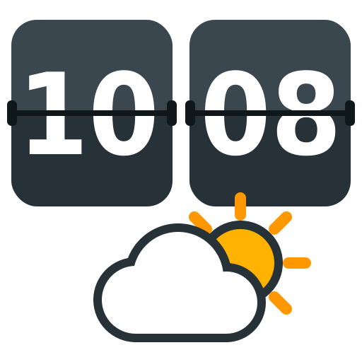

<p align="center"></p>

# HomeAssistant HTC Flipclock with Weather card
[](https://github.com/iamBiB/lovelace-htc-flipclock-weather/releases/latest)

HTC-style flip clock with weather and forecast for [Home Assistant](https://www.home-assistant.io/).

### White theme

### Dark theme

### With custom entity


# Support
Hey dude! If you like it .. well :beers: or a :coffee: would be nice :D

[](https://www.buymeacoffee.com/fhc0C7A)

## What's new in v2
- **Responsive.** The card scales to any width: phone, tablet, narrow or wide dashboard columns. It works in the sections view.
- **No dependencies.** jQuery and the external Lit/wired imports are gone. Everything loads from your own Home Assistant.
- **Smooth 3D flip animation** instead of image frames. The animation turns off if your device has "reduce motion" enabled.
- **Live forecast.** It uses Home Assistant's forecast subscription, so the forecast updates without reloading the page.
- **Multiple cards, multiple time zones.** Each card can have its own `timezone` and `time_entity`.
- **Shared icon sets.** Any theme can use any icon set (`htc`, `dusk`, `picto`).
- **Fixes:**
  - Tapping the card opens the weather entity's details.
  - Night icons are shown after sunset.
  - Wind and temperature use the units reported by your weather entity.
  - 12-hour mode shows 12 instead of 00.

## Install

### Requirements
The clock follows Home Assistant's server time through the **Time & Date** integration.
Add it via **Settings → Devices & Services → Add Integration → Time & Date** and enable **Date & Time (ISO)**. This creates `sensor.date_time_iso`.

> The old YAML `platform: time_date` setup is no longer supported by Home Assistant. Use the integration instead.

If the sensor doesn't exist, the card falls back to the browser's clock and logs a warning in the browser console.

<!-- ha-marketplace:exclude-start -->
### Marketplace
Requires Home Assistant 2026.11 or newer.

1. Go to **Settings → Marketplace**.
2. In the upper-right corner, select **Add from link**.
3. Under **GitHub link**, enter `iamBiB/lovelace-htc-flipclock-weather` and select **Add**. If Marketplace asks for the type, choose **Dashboard** and select **Add** again. The first time you add a repository by link, Marketplace asks you to connect GitHub: select **Continue** and enter the code shown on GitHub.
4. Open **HTC Flip Clock & Weather**, select **Install**, check the version, and select **Install** again.
5. Refresh your browser (Ctrl/Cmd+Shift+R).

Marketplace adds the dashboard resource for you. Updates appear under **Settings → Updates**.

### Manual install
1. Download the latest [release](https://github.com/iamBiB/lovelace-htc-flipclock-weather/releases/latest) and copy the **contents of the `dist` folder** into `config/www/custom_ui/htc-weather/`, so you end up with `config/www/custom_ui/htc-weather/htc-flipclock-weather.js`.
2. Add the resource: **Settings → Dashboards → ⋮ (top right) → Resources → Add resource**
   - URL: `/local/custom_ui/htc-weather/htc-flipclock-weather.js?v2.2.0`
   - Type: **JavaScript module**
3. Refresh your browser (Ctrl/Cmd+Shift+R).

If you use YAML-mode dashboards:
```yaml
resources:
  - url: /local/custom_ui/htc-weather/htc-flipclock-weather.js?v2.2.0
    type: module
```
<!-- ha-marketplace:exclude-end -->

### Upgrading from v1
- **Manual install:** delete the old `htc-weather` folder, then copy the contents of `dist` into it as above. This clears out leftover v1 files like `themes.js` and `lib/`. The resource URL stays the same; just bump the `?v` number so browsers load the new version.
- **Switching to Marketplace:** delete the old `www/custom_ui/htc-weather` folder and remove its entry under **Settings → Dashboards → Resources**, then install as above.
- Your existing card configuration keeps working. The only change is that `renderForecast` now defaults to `true`.
- Weather icons moved from `themes/<theme>/weather/<set>/` to the shared folder `themes/icons/<set>/`.

## Updating
- **Marketplace:** install the update when it shows up under **Settings → Updates**, then refresh the browser (Ctrl/Cmd+Shift+R).
- **Manual:** copy the new `dist` contents over the old ones, then bump the `?v=` number in the resource URL so browsers load the new version.

The browser console shows the loaded version as `HTC Flip Clock x.y.z`.

## Using the card

### Options

| Name | Type | Default | Description |
|------|------|---------|-------------|
| `type` | string | **required** | `custom:htc-weather-card` |
| `entity` | string | **required** | A `weather.*` entity. |
| `title` | string | friendly name | Text shown instead of the weather entity's name. |
| `lang` | string | `en` | Day names and wind directions: `en`, `ro`, `nl`, `cz`, `sv`, `it`, `pt`, `no`, `dk`, `de`, `fi`, `fr`. Other language codes fall back to your browser's day names. |
| `am_pm` | bool | `false` | 12-hour clock with AM/PM indicator. |
| `timezone` | string | — | Show the time in another time zone, e.g. `America/New_York`, `Asia/Tokyo`. Leave it out to use Home Assistant's time. |
| `time_entity` | string | `sensor.date_time_iso` | Time & Date sensor used as the clock source. |
| `svrOffset` | int | `0` | Shift the clock by this many seconds. |
| `renderClock` | bool | `true` | Show the flip clock. |
| `renderForecast` | bool | `true` | Show the forecast row. |
| `forecast_days` | int | `4` | Number of forecast entries (1–7). |
| `renderDetails` | bool | `true` | Show sunrise/sunset, wind and last-update time. Sunrise/sunset needs `sun.sun`. |
| `temperature` | object | — | Customize the current temperature on the left. Keys: `entity`, `decimals`, `title` (all optional). See the example below. |
| `high_low_entity` | object | — | Replace today's high/low with any entity. Keys: `entity_id`, `name`. |
| `theme.name` | string | `default` | `default` or `dusk`. |
| `theme.weather_icon_set` | string | `default` | `htc`, `dusk`, `picto`, or `default` (the theme's own set). |

### Examples

#### Standard card
```yaml
type: custom:htc-weather-card
entity: weather.home
```

#### Dusk theme with HTC icons
```yaml
type: custom:htc-weather-card
entity: weather.home
theme:
  name: dusk
  weather_icon_set: htc
```

#### Second city in another time zone
```yaml
type: custom:htc-weather-card
entity: weather.tokyo
title: Tokyo
timezone: Asia/Tokyo
```

#### Custom entity instead of high/low
```yaml
type: custom:htc-weather-card
entity: weather.home
high_low_entity:
  entity_id: sensor.outdoor_humidity
  name: Humidity
```

#### Local sensor for the current temperature
The weather entity's temperature comes from a forecast service and can differ from your own outdoor sensor. Use `temperature` to show the sensor instead:
```yaml
type: custom:htc-weather-card
entity: weather.home
temperature:
  entity: sensor.outside_temperature
  decimals: 1
  title: Outside
```
- `entity`: any numeric sensor. The card uses the sensor's unit. If the sensor is unavailable or not a number, the card shows the weather entity's temperature instead.
- `decimals`: always show this many decimals, so `18` becomes `18.0` with `decimals: 1`. Without it, the temperature is rounded to at most one decimal.
- `title`: text shown above the temperature. Without it, the card uses `title`, then the weather entity's name.

The weather icon, today's high/low and the forecast still come from the weather `entity`.

#### Clock only
```yaml
type: custom:htc-weather-card
entity: weather.home
renderForecast: false
renderDetails: false
```

## Repository layout
```
├── hacs.json
├── README.md
├── LICENSE
├── docs/images/                       icon (SVG + PNG)
└── dist/                             everything Marketplace installs
    ├── htc-flipclock-weather.js      the card
    ├── regional.js                   day names / wind directions per language
    └── themes/
        ├── default/   panel background + clock digits
        ├── dusk/      clock digits
        └── icons/     weather icon sets shared by all themes
            ├── htc/
            ├── dusk/
            └── picto/
```

## Problems?
There might be :D .. So give me a shout for issues or even updates :D

## License
This project is under the [MIT license](LICENSE).
